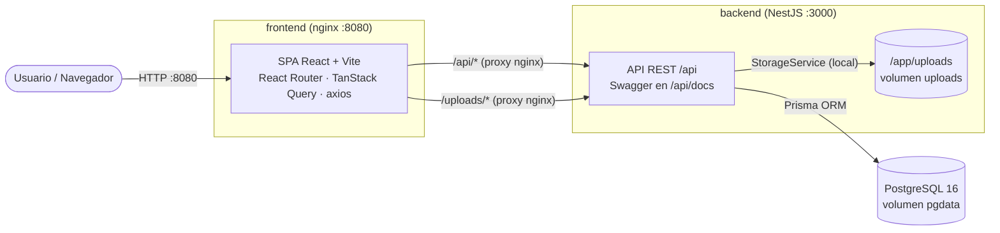
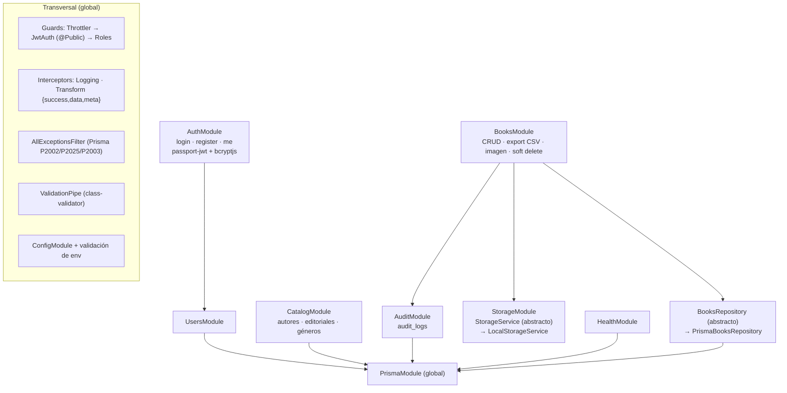
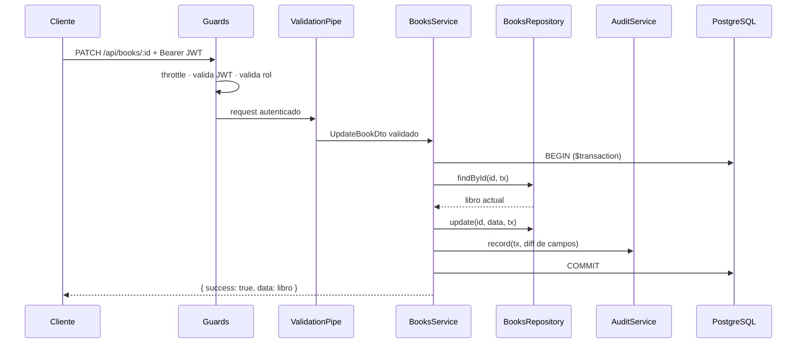
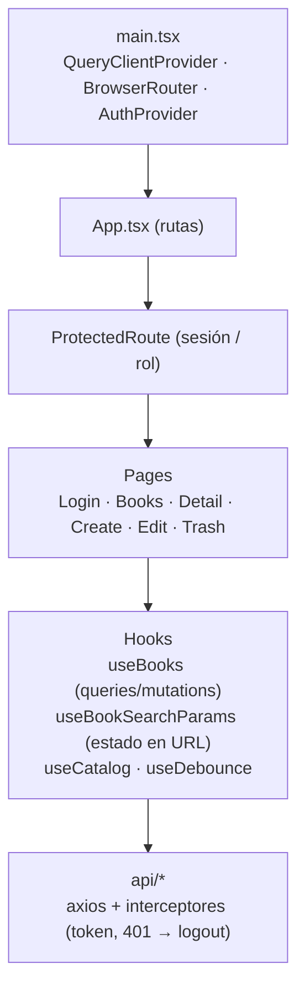

# Arquitectura

## Vista general (despliegue con Docker)

nginx sirve el build estático del frontend y hace de reverse proxy de `/api` y `/uploads`. Así el navegador ve un solo origen: no hay CORS en producción y el JWT viaja en el header `Authorization`.

## Módulos del backend

## Flujo de una escritura (ej. `PATCH /api/books/:id`)

Si cualquier paso falla, la transacción hace rollback y ni el libro ni el registro de auditoría quedan escritos. El filtro global traduce el error a una respuesta uniforme.

## Frontend

- **Estado del servidor**: TanStack Query, con caché, `keepPreviousData` al paginar e invalidación tras cada mutación.
- **Estado del listado**: filtros, orden y página viven en la URL (`useSearchParams`), así que se pueden compartir y sobreviven a una recarga.
- **Formularios**: react-hook-form + zod, con validación en `onChange`.
